# WowCube game pipeline: the flow

End-to-end flow driven by `cube_orchestrator`, from a request to a verified `.oct` on
the user's cube. The default run mode is **autonomous**: the only stop is the style lock
(`STOP, always`); the stops marked `STOP, stepwise` happen only when the user asked for
stepwise mode ("stepwise"). Rules: `skills/cube_orchestrator/SKILL.md` and its
`references/`.

```mermaid
flowchart TD
    U(["User: make a game / continue / mod / upload"]) --> ORCH["cube_orchestrator"]
    ORCH --> CHK["Entry checks: build or mod, run mode,<br/>SDK octavios dev 609d5ae+ and telemetry, Codex login"]
    CHK -->|"SDK or toolchain missing"| ENV["Tell the user the exact update commands;<br/>design, prompts and art go on; wait before the infra gate"]
    CHK --> DET{"Stage detection:<br/>first step not done"}

    DET -->|"no GDD"| S1["Stage 1: cube_game-designer<br/>GDD checked against GAME_FEEL"]
    S1 --> CP1{{"STOP, stepwise: review the GDD"}}
    CP1 --> S2
    DET -->|"no prompts or manifest"| S2["Stage 2: technical_prompter<br/>prompts with test hooks + manifest with Codex prompts"]
    S2 --> CP2{{"STOP, stepwise: review prompts and manifest"}}
    CP2 --> INFRA
    DET -->|"no app folder or infra not ok"| INFRA["Infra gate: wowcube-boilerplate<br/>dev layout, simulators build, hidden smoke run:<br/>the agent checks Demo 0's expected screens<br/>(a failed step is retried alone, never a new scaffold)"]

    INFRA --> GATE3["Manifest gate: build_pipeline.py validate<br/>(no generation, no network), then sizes, panoramas, sounds"]
    DET -->|"no style lock"| GATE3
    GATE3 -->|"fails"| S2
    GATE3 --> SL["cube_art-director: style bible, style frames,<br/>in-game mock of one face; CC0 sound list"]
    SL --> LOCK{{"STOP, always: the user approves the style and the sound list"}}
    LOCK -->|"change"| SL
    LOCK -->|"approved"| GEN["Codex generation via art.py<br/>family leaders first, then the batch"]
    DET -->|"pack-status not current"| GEN
    GEN --> QA{"Every QA rule passes?"}
    QA -->|"no: cause-level fix in fixes.json, redraw failures"| GEN
    QA -->|"yes"| FRESH["Fresh-agent consistency review + review.html"]
    FRESH --> CP3{{"STOP, stepwise: the user reviews the batch"}}
    CP3 --> SND["Sound: approved CC0 downloads, sound_kit build and loop,<br/>inspect by numbers, CREDITS.md"]
    SND --> PACK["Launcher icon + fonts, then pack (refuses an incomplete set):<br/>index.bin, art/packed, sound/assets, ids header, .pack_inputs.json"]

    PACK --> CODER["Stage 4, prompt N: coder subagent"]
    DET -->|"prompts left"| CODER
    CODER --> CHECKS["In parallel: Requirements + Template agents on the code;<br/>visual gate: hidden muted simulator, 24-screen frames, the agent looks"]
    CHECKS --> PLAY["Playtest Agent over the control socket<br/>on the hidden instance"]
    PLAY --> PASS{"90 and 90, no critical issue anywhere,<br/>no major visual finding, playtest 90,<br/>no open major from any agent?"}
    PASS -->|"no, under 5 rounds"| FIX["Fixer: all issues + the frames that show them"]
    FIX --> CHECKS
    PASS -->|"no, 5 rounds used"| DEG["Autonomous: rescope the prompt, record the cut.<br/>Stepwise: ask rescope, retry or stop"]
    DEG -->|"rescoped prompt: every gate again"| FIX
    PASS -->|"yes"| SAVE["Save context + frames"]
    SAVE --> CP4{{"STOP, stepwise: per-prompt checkpoint with the frames"}}
    CP4 -->|"more prompts"| CODER
    CP4 -->|"all done"| S5

    DET -->|"no verified .oct"| S5["Stage 5: hooks off, version bump,<br/>octpack-build into dist, mandatory verification<br/>(octpack-info or the local header check)"]
    S5 --> UPQ{"User asked to upload?"}
    UPQ -->|"yes"| UPL["tools/cube_upload on Windows or spptest on Linux;<br/>restart the cube; on-device checklist"]
    UPQ -->|"no"| REP
    UPL --> REP(["Final report: file, what the agent saw, cuts,<br/>temporary parts, credits, controls"])
    REP -.->|"balance pass or mod"| ORCH
```

## Legend

- Rounded nodes: start and end.
- Rectangles: work done by a sub-skill, a subagent or the orchestrator's own tools.
- Diamonds: decisions and gates.
- Hexagons `{{ … }}`: stops. `STOP, always` happens in every run mode unless the user explicitly
  waived it; `STOP, stepwise` only in stepwise mode (autonomous mode prints a progress line
  and continues).

## Stage summary

| Stage | Owner | Produces |
|---|---|---|
| 1. Design | `cube_game-designer` | `plans/<game>_gdd.md` |
| 2. Prompts | `technical_prompter` | `plans/<game>_prompts.md`, `plans/<game>_assets.json` |
| Infra gate | `wowcube-boilerplate` | `app_<game>/` (octavios dev layout), hidden and user simulators |
| 3. Assets | `cube_asset-builder` + `cube_art-director` + consistency reviewer | style lock, `assets_<game>/art/`, sounds, icon, packed `app_<game>/index.bin`, `art/packed/`, `sound/assets/`, `src/app_<game>_ids.h` |
| 4. Implement | coder, `cube_verifier` agents, fixer; the orchestrator's visual gate | `app_<game>/src/app_<game>.h`, frames per prompt |
| 5. Deliver | `wowcube-boilerplate`; `tools/cube_upload` / `spptest` | `dist/app_<game>.oct`, upload, video, balance passes |

## Key points

- **Single entry point**: the user talks to `cube_orchestrator`; it routes and resumes
  from files (`plans/`, `assets_<game>/`, `app_<game>/`, `context/`).
- **One creative stop**: the style lock (style frame + in-game mock at cube resolution)
  and the sound download list are approved together before mass generation.
- **Art on the subscription**: Codex CLI with ChatGPT, no API key; QA until every rule
  passes; paid APIs and placeholders only as fallbacks.
- **The agent looks at every build**: after every coder and fixer run the hidden,
  muted simulator dumps all 24 screens and the orchestrator inspects them; the Playtest
  Agent drives taps, twists and tilt through the control socket. Code-only
  verification once missed a rendering bug on all 24 screens.
- **No prompt completes with a failing gate**: any critical issue fails its check
  whatever the score; after 5 fix rounds the prompt is rescoped and the rescoped version
  must pass every gate (`skills/cube_orchestrator/references/RUN_MODES.md`).
- **Device package without a simulator**: `octpack-build` (fallback: the pure-Python
  builder) into `dist/`, verified every time (unverifiable = failed); the stock Windows
  simulator rewrites `app_<game>/app_<game>.oct` on every start, so that file is never
  delivered.
- **Upload on request** over Bluetooth, then a cube restart and the on-device checklist.
- **Safety**: no windows over the user's screen, no audio, no global input, PID-only
  process kills (`skills/cube_orchestrator/references/AGENT_SAFETY.md`).
