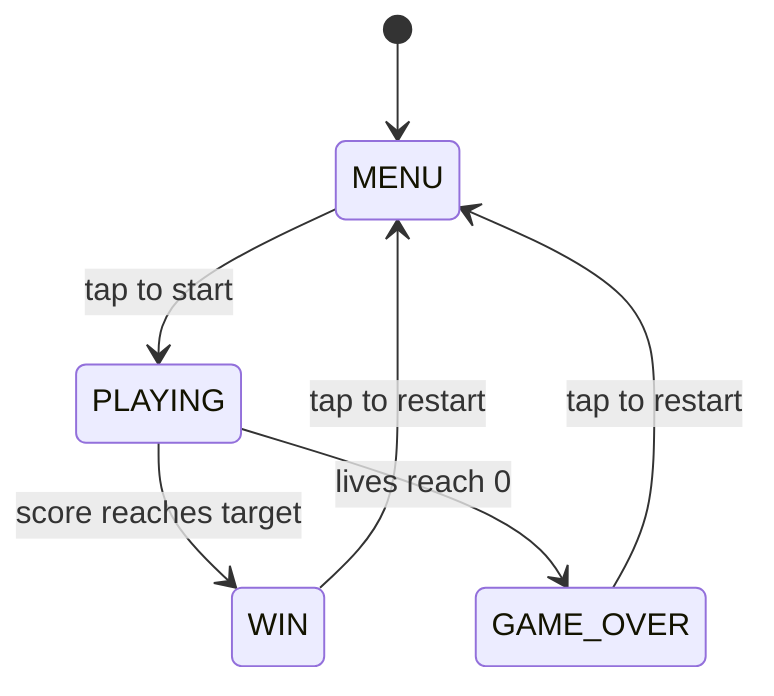
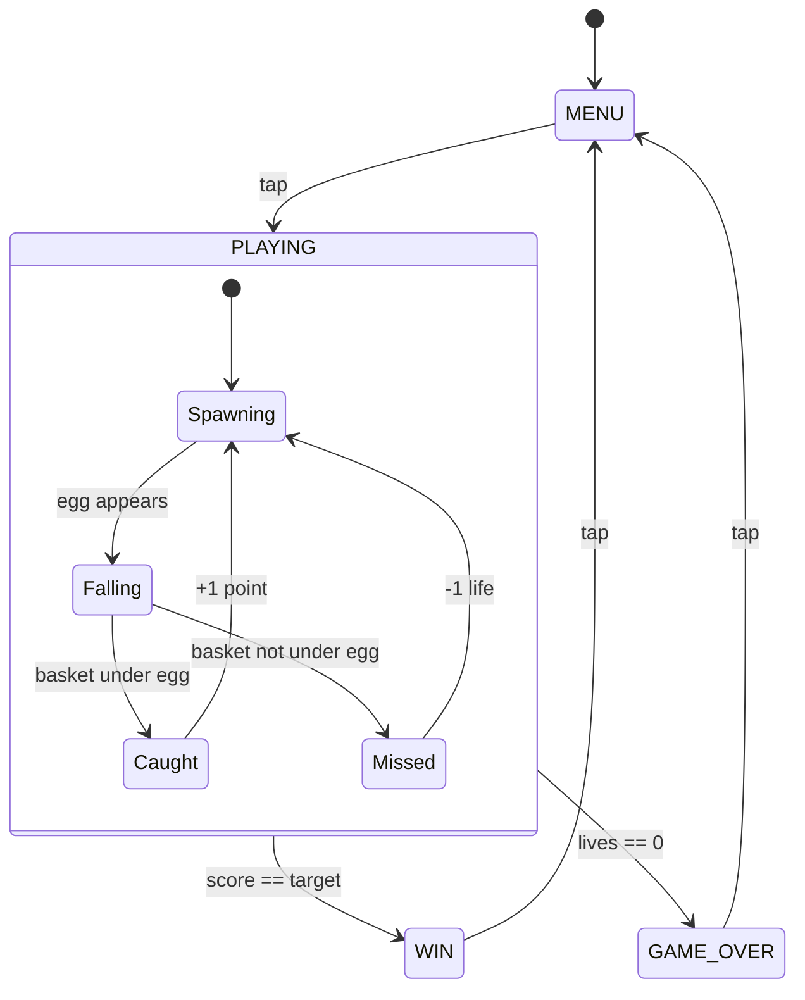

# WowCube Game Designer

> **This skill is Stage 1 of the `cube_orchestrator` pipeline.** The orchestrator invokes it (via the Skill tool) when stage detection finds no GDD. It is not a user-facing entry point — for any WowCube game request, the user enters through `cube_orchestrator`, which routes here.

Create a non-technical Game Design Document (GDD) from a user's game idea, accounting for WowCube hardware and interaction specifics. The GDD is the Stage 1 artifact; `cube_orchestrator` hands it to Stage 2 (`technical_prompter`), after a checkpoint in stepwise mode.

**Core principle:** in **stepwise mode** the agent MUST first ask as many clarifying questions as needed to understand the user's vision — never guess; the discovery conversation is the most important part of the process there. In **autonomous mode** (the default; see `cube_orchestrator/references/RUN_MODES.md`) the interview does not run: the orchestrator's intake already supplied a concept fragment (or "на твой вкус" / the `YOLO` token), and this skill expands it with its own design judgment, listing every decision under Design Assumptions.

## When to Use

- `cube_orchestrator` routed here because stage detection found no `plans/<game>_gdd.md`
- The orchestrator needs a GDD before it can drive Stage 2 (prompts)

Do not trigger this skill directly for "make a game" / "design a game" requests — those are owned by `cube_orchestrator`, which routes here as Stage 1.

## When NOT to Use

- A GDD already exists — the orchestrator will route to Stage 2 (`technical_prompter`) instead
- The request is to modify existing code — this skill produces design documents, not code

## WowCube Device Essentials

The GDD must account for these device characteristics (expressed in player-friendly terms, never as code). Exact engine numbers live in one place: `<skills>/templates/app_ai_template/API.md`.

- **The cube has 6 faces**, each with **4 small screens** (24 screens total)
- **Each screen sits on its own physical module.** A face's four screens live on four *different* modules; two adjacent faces share exactly two of those modules (the ones along their common edge); opposite faces share none. This matters for animation placement — see the Assets section below.
- **Screens are 240x240 pixels** with a **physical gap** (border) between them
- **Sprites are authored at HALF the on-screen size** — the engine applies a software ×2 upscale at draw time. So **authored size = intended on-screen size ÷ 2**, with a hard maximum of **120×120** (a full-screen sprite). A quarter-screen object is 30×30, etc. Whenever the GDD states a sprite size, it MUST be the authored (pre-upscale) size, never the on-screen size. The one exception: art explicitly marked **fullsize** draws 1:1 (no upscale) and may be authored at native resolution up to 240×240 — as **palette fullsize** (keeps transparency) or **full-color fullsize** (real color depth, fully opaque). See the Assets section below.
- **Player interactions**: twist one layer of the cube (a full quarter turn, or a half-twist: start a turn and let it snap back), tap a face or a specific screen, tilt the cube
- **Twists** turn one face together with the layer behind it. The cube is 2×2×2, so a twist moves 4 of its 8 modules and 12 of its 24 screens: the turned face's own 4 screens rotate in place (a disk), and the 8 screens bordering it on the four side faces (two rings of 4, two screens per side face) travel round to the next side face. This is the primary input for most games.
- **Half-twists** are a turn-and-return: the player starts a twist and the layer snaps back. The game is told about it, but **nothing moves** (no screen and no object changes place). Use it only as a deliberate custom action ("flick to fire"), never as a smaller movement.
- **Taps** always tell which face was tapped. On current firmware (octavios dev) the cube also tells **which of the face's 4 screens** was struck, so "tap the star on this screen" is a valid design. Older firmware knows the face only, so any per-screen tap needs a sensible per-face fallback (e.g. "tapping a face acts on the screen closest to the action"); say so in Design Assumptions.
- **Tilt/gravity** detects which face is on top and which way the cube leans
- **Shake is not a control**: it always takes the player back to the home screen.
- The cube can display on all 24 screens simultaneously — not all are visible to the player at once
- **20 updates per second.** Never design (or describe to the player) an animation faster than 20 frames per second. There is **no length or size budget**: long animations and video-like sequences are fine (the app's size is not a practical limit); choose clip length for readability.
- **Limits worth designing around**: about **60 text labels whose text changes** (scores, timers, counters; fixed captions are not limited); up to **512 sprites drawn on one screen** (extras silently vanish); the scene's objects share one module's 256 KB of memory with the code, so keep the worst case **well under ~1500 objects**; about **100 engine-driven movements (tweens)** at once. Beyond that it is performance common sense — don't design mechanics that spawn thousands of new objects every tick.
- **Sound**: each module plays **up to 6 sounds at once** (music and effects add up, they do not cut each other); sounds can be long (a music loop); a sound can come **from the screen where something happens**; a playing sound **cannot be stopped**, so music is a short loop (10-20 s) the game restarts.
- **Saves**: the cube keeps a small save area per game (best score, unlocked levels, settings, a run in progress). A game is **never resumed** after the cube sleeps or the player leaves: it starts again and restores what was saved.
- **Idle**: 60 s without motion or input pauses the game (battery save); the cube sleeps 5 minutes later.

## Workflow

### Step 1: Discovery Interview (MANDATORY in stepwise mode)

**Run-mode note:** in autonomous mode the interview below is replaced by the single intake concept answer the orchestrator already collected. Expand it into the GDD directly; do not stop to ask questions. The MUSTs in this step apply in **stepwise mode**.

**Do NOT write the GDD until you have asked the user enough questions to fully understand their game idea.**

#### How to Generate Questions

There is no fixed list of questions. Instead, the agent must:

1. **Read the user's initial prompt** carefully and identify what is clear vs. what is ambiguous or missing.
2. **Read `<skills>/templates/app_ai_template/API.md`** (engine facts and limits) and skim `src/app_ai_template.h` (annotated API with demos) to understand what the platform can do. Use this technical knowledge to identify design questions the user hasn't addressed — but phrase all questions in plain, non-technical language.
3. **Cross-reference the user's idea against the WowCube Device Essentials** listed above. For each cube mechanic (twists, half-twists, taps, tilt, multi-face display), determine whether the user's idea has a clear mapping. If not, ask about it.
4. **Think about the game holistically** — gameplay flow, win/lose conditions, progression, player motivation. Always cover: the **art style** (ask for reference images — their own drawings, sprites or screenshots they like; they become the style references), **music and sound mood**, **what is remembered between sessions** (saves), and **which numbers set the pace** (speeds, spawn rates).
5. **Read `references/GAME_FEEL.md`** and ask about anything in the idea that would break one of its rules (unreadable threats, enemies faster than the player can react, a backdrop repeated on every screen).

#### Interview Rules

- **Ask every question you have (stepwise mode).** Group related questions together for efficiency (2-4 rounds of questions is typical), but do not hold back questions to be polite. More questions upfront = better GDD.
- **Acknowledge the idea first** — briefly restate what you understood from the user's prompt to confirm alignment before asking questions.
- **After receiving answers, check for gaps** — if answers raise new questions or leave things ambiguous, ask follow-up questions. Continue until you are confident you understand the full game design.
- **Confirm understanding** — before proceeding to write the GDD, summarize the complete game concept back to the user and get their approval.
- If the user says "you decide" for a specific aspect, make a design decision and note it as an assumption in the GDD.
- If the user wants to skip the interview entirely, explain briefly why the questions matter for quality, then ask at minimum about: the core mechanic, how twists should work in the game, and win/lose conditions.

### Step 2: Study the Platform

Read for internal understanding only:
- `<skills>/templates/app_ai_template/API.md` — engine facts, limits, art tiers, sound mixer, saves (the shared reference)
- `<skills>/templates/app_ai_template/src/app_ai_template.h` — annotated API and engine patterns (do NOT copy demo code)
- `references/GAME_FEEL.md` — lessons from shipped builds (pacing, telegraphed threats, hit weight, composing across 24 screens, sound)

Use this knowledge solely to validate that the user's design is feasible on the hardware. If any aspect of the design conflicts with platform limitations, go back to the user (stepwise) or adjust it and record why (autonomous), in plain language.

**None of this technical knowledge should appear in the GDD.**

### Step 3: Write the GDD

Create a markdown file at `plans/<game_name>_gdd.md` (`<game_name>` in snake_case; it becomes `app_<game_name>` and `assets_<game_name>/`). The GDD is a **non-technical creative document** — it describes the game from the player's perspective. No code, no API names, no implementation details. Write it in the user's language; asset names stay English `snake_case`.

The GDD structure is designed so that `technical_prompter` can easily extract:
- **Game objects** → sprite definitions and struct fields
- **Controls** → input handler logic
- **Game flow states** → game state machine and transitions
- **Tunables** → one block of balance constants
- **Assets, art style, music and sound** → the asset manifest, its style string and its sound list
- **Saves, testing and delivery** → save, test-hook and delivery prompts
- **MVP scope items** → individual implementation prompts

````markdown
# <Game Name> — Game Design Document

## 1. Concept

### Overview
2-3 sentences: what the game is, what makes it fun, why it works on the cube.

### Art Style (feeds the style lock)
The first picture the user approves (the **style frame**) is drawn from this
section, and every later sprite is held to that frame.
- **In one line**: e.g. "dark top-down pixel art, chunky crisp pixels, bold dark outlines, muted browns and grey-greens, one warm accent"
- **Viewpoint**: top-down / side view / isometric / flat front (UI and text are usually flat front)
- **Palette and mood**: named core colours, accent colours and where they may appear, forbidden colours
- **Rendering**: outline (colour, thickness), shading (how many tone steps), light direction, how much detail survives at the tiny final size
- **References**: images the user gave (file paths) and reference games
- **Style frame**: what the first approved picture shows — one screen at real size with the main background, the hero, one enemy or key object and one HUD element

### Scope

**MVP (minimum viable version):**
Group features by implementation area. Each item should be a discrete,
testable behavior — these map roughly to implementation prompts later.

Foundation:
- [ ] Feature (e.g., "game board displays on all 6 faces")

Core mechanics:
- [ ] Feature (e.g., "twisting moves tiles between screens")

Secondary mechanics:
- [ ] Feature (e.g., "bonus tiles appear every 30 seconds")

UI & feedback:
- [ ] Feature (e.g., "score displays on top face")

Audio:
- [ ] Feature (e.g., "music loop on the title and during play", "shot + hit sound on every kill")

**Future features (beyond MVP):**
- Feature A

### Design Assumptions
List any decisions made by the agent that were not explicitly stated by the user:
- Assumption — rationale
(If none, state "All design decisions were confirmed with the user.")

## 2. How It Plays

Describe the core gameplay experience in plain language. What does the player do moment-to-moment? What makes it engaging?

For each distinct mechanic, describe:
- What the player sees and does
- How it maps to cube interactions (twist/tap/tilt)
- Rules and edge cases
- What feedback the player gets (visual and audio): every threat has a visible wind-up, every hit a visible and audible reaction (see GAME_FEEL.md)

## 3. Game Objects

| Object | Appearance | Behavior | Max on screen |
|--------|------------|----------|---------------|
| ... | What it looks like | What it does | e.g., 24 (one per screen) |

**Object count:** estimate the worst-case number of objects across all faces
(sprites + text characters). A sanity check, not a budget: flag only designs
that approach ~1500 objects in one scene or 512 on one screen, or that spawn
huge numbers every tick.

## 4. Progression & Difficulty

- How the game progresses (levels, waves, endless, etc.)
- What changes as difficulty increases
- Win condition
- Lose condition
- Scoring system (if any)

### Tunables
Every number that sets the pace, in one table (expect two or three balance passes after the first playable build):

| Tunable | Value | Unit | Expected to move? |
|---------|-------|------|-------------------|
| Player step time | 1.2 | s | yes — feel |
| Enemy step time (normal / fast / heavy) | 3.2 / 2.0 / 4.8 | s | yes |
| Spawn interval per wave | 3 / 2 / 1.5 | s | yes |
| Attack wind-up | 1.0 | s | no |

## 5. Controls

| Input | What It Does |
|-------|-------------|
| Twist left/right | ... |
| Half-twist left/right | ... (turn-and-return: a custom action only, nothing moves) |
| Twist up/down | ... |
| Half-twist up/down | ... (turn-and-return: a custom action only, nothing moves) |
| Tap (any screen of a face) | ... |
| Tap (a specific screen) | ... (current firmware; give the per-face fallback) |
| Tilt/gravity | ... |

Mark any input as "not used" if the game does not use it.

## 6. Screens & Feedback

- What the player sees on each face during gameplay
- Where score/status info is displayed
- Menu screens (start, pause, game over, win)
- Visual feedback (animations, color changes, effects)
- Audio feedback (when sounds play, what mood they convey)

### Composition across the cube
- For every element: does it live on **one screen**, **one face**, or **repeat on every face**? (HUD usually repeats on each side face; the playfield usually lives on one face.)
- Scenery spanning several screens or faces is **one picture split per screen**: continuous and upright around the four side faces, never the same tile repeated on every screen.
- **Unique objects appear once on the cube** (one moon, one sun): name the face and screen, and what happens when the cube is turned.
- Tilt-driven games: which face is the playfield and what the other faces show meanwhile.

## 7. Assets

### Sprites
- `<snake_case_name>` — description and approximate **authored** size.

Names: `snake_case` starting with a letter, at most **23 characters**, never a name the packer reserves (`icon`, `ico`, `pal`, `none`, `last`, `zero`, …; the full list is in `technical_prompter` Step 4).

**Sprite sizes are authored (pre-upscale) sizes — always ≤ 120×120, unless the
sprite is marked fullsize — see the tier table below.** The engine
upscales every regular sprite ×2 at draw time, so the size written here is *half* how big
the sprite appears on the 240×240 screen: **authored size = intended on-screen size ÷ 2.**
- Full screen → `120x120` (the maximum; never write a size larger than 120 in either dimension, unless the sprite is marked fullsize)
- Half the screen (each side) → `60x60`
- A quarter of the screen (each side) → `30x30`
- A small icon/item → size it down proportionally the same way

Example: `hero — small character, occupies about a quarter of a screen → 30x30px`.
Do NOT write the on-screen size (e.g. `60x60` for a quarter-screen sprite) — halve it.

**Art tiers.** The default (regular) tier is right for almost everything; mark a
sprite **fullsize** (and optionally **full-color**) only when the design truly
needs native-resolution art:

| Tier | Listed size | Colors & transparency | Drawn at | Use for |
|------|-------------|-----------------------|----------|---------|
| Regular (default) | ≤ 120×120 (= on-screen ÷ 2) | shared palette, transparent background supported | ×2 upscale | characters, items, icons, effects — anything |
| Palette fullsize | native, up to 240×240 | shared palette, transparency KEPT | 1:1, no upscale | crisp native-resolution art that still needs a see-through background |
| Full-color fullsize | native, up to 240×240 | full color depth, NO transparency | 1:1, no upscale | fully opaque backdrops, photographic full-screen scenes |

Full-color art has NO transparency, so anything that needs a see-through
background must be a regular sprite or a palette fullsize sprite. Opaque
full-screen backgrounds are best marked **full-color** (a regular-palette
background once rendered in the wrong colours). Choose the tier by what the
art needs (transparency, native sharpness, real color depth); there is no
practical limit on total art size or frame count.

**Animation guidance.** Whenever the design calls for an animated sprite:
- **20 frames per second at most.** Never describe or plan anything faster.
- **No length budget**: list as many frames as the motion needs; long clips and video-like sequences are fine. Pick the length for readability.
- **Full-color fullsize animations only when the user explicitly asks for one**; flag it in the Assets section with a "handle carefully" note.
- **At most one animated full-screen (fullsize) picture per physical module** — the owner's guideline, **informational until the owner confirms it** (it never blocks a design). Ordinary sprite animations (characters, effects) are not limited by it. Because a face's four screens sit on four different modules (and adjacent faces share two), when the design has more than one animated full-screen picture, note which screen each one occupies so it can be checked.

Total sprite assets: N

### Music & Sound
- **Music bed** (required; leave it out only when the game should be silent apart from effects, and then write "No music" with the reason): mood, tempo, instruments; loop length 10-20 s (the game restarts it; a playing sound cannot be stopped); where it plays (title / play / end screens); it sits under the effects.
- **Event table** — one row per moment that makes a sound:

| Event | Sound | Mood / character | Plays from |
|-------|-------|------------------|------------|
| Shot that hits | `shotgun_hit.mp3` (≈0.9 s) | dry blast, low thump, wet hit, pump rack | everywhere |
| Enemy appears | `zombie_growl.mp3` (≈1.3 s) | low raspy moan | the screen where it appears |

- **One sound per moment**: when two things happen together (a shot that also kills) list one combined sound, not two sounds on the same instant.
- At most about 4 effects at once next to the music on one module (6 voices in total).
- **Source**: real recordings from CC0 libraries (OpenGameArt, Kenney, Freesound with a CC0 filter), layered and mastered per event; the asset stage proposes the list (file, source, licence, size) and the user approves it before anything is downloaded. Synthesised beeps are placeholders only.

Total sound assets: N

### Fonts
- `<font_name>` — usage description (the template's fonts unless the style needs others)

## 8. Game Flow

Describe the full flow of the game using a **Mermaid state diagram**.
Each state becomes a game state in implementation. Transitions between
states map to game logic that the technical prompter will decompose.



Make the diagram detailed — include all transitions with their trigger
conditions on the arrows. If a state has internal sub-states (e.g.,
PLAYING has "spawning egg" → "egg falling" → "catch/miss"), show them
as a nested state:



Below the diagram, describe each state:
- **Name** — clear, descriptive (e.g., MENU, PLAYING, GAME_OVER, WIN)
- **What the player sees** — screen contents and active objects
- **Active inputs** — which controls respond in this state
- **Transitions** — what triggers moving to another state
- **Entry actions** — what happens when entering this state (sounds, animations, resets)

## 9. Saves
Only when the game remembers something between sessions; otherwise write
"No saves: every launch starts fresh."
- What is kept (best score, unlocked levels, settings, a run in progress)
- When it is saved (end of a round, when the game closes)
- What a reset or "new game" clears

## 10. Testing & Delivery
- **Autoplay**: how the game plays itself in test builds (which inputs a simple bot gives, so every mechanic gets exercised and rounds restart on their own) — used for automatic screenshots, balance runs and the gameplay video
- **Mute**: test builds make no sound
- **Playfield pin** (tilt or face-up games): which face the playfield is forced to in test builds
- **Launcher icon**: what the hexagon badge shows (the hero or key object, in the game's style, readable at small size)
- **Gameplay video** (optional: offered at delivery, made when the player wants it): what a 20-40 s clip would show
````

### Step 4: Validate the Design

Before finalizing, verify:

1. Every player action (twist, tap, tilt) has a defined response in every game state, or is explicitly marked "not used"
2. Win and lose conditions are complete — no dead-end states
3. The asset list covers every visual and audio element mentioned in the design
4. Asset names are unique, descriptive, `snake_case` starting with a letter, at most 23 characters, and never a reserved name (`icon`, `ico`, `pal`, `none`, `last`, `zero`, …)
5. The game is feasible given the device constraints (screen count, input types, about 60 changing text labels)
6. **Object count sanity** — the worst case stays well under ~1500 objects in a scene and 512 on one screen; nothing spawns huge numbers of objects per tick
6a. **Sprite sizes are authored sizes** — every sprite size in §7 is ≤ 120×120 (full-screen = 120×120) and equals the intended on-screen size ÷ 2 (e.g. a quarter-screen object is 30×30, not 60×60). Any size > 120, or any size written in on-screen pixels, is wrong — fix it. The one exception: a sprite explicitly marked **fullsize** draws 1:1 and may be listed at native size up to 240×240; a **full-color** sprite that needs transparency is a design error (use palette fullsize instead).
7. The controls summary matches the mechanics described in the gameplay section
7a. **Per-screen taps** — if any mechanic depends on which screen was tapped, Design Assumptions says it needs current firmware and the Controls table gives the per-face fallback
8. The document is understandable by someone who has never seen WowCube code
9. All user answers from the discovery interview are reflected in the document
10. All assumptions are explicitly listed in the Design Assumptions section
11. The GDD contains zero technical implementation details — no code, no API names, no engine internals
12. **MVP scope items are grouped** by area (foundation/core/secondary/ui/audio) and each item is a discrete testable behavior
13. **Game flow states** are named clearly and all transitions are defined
14. **Animation placement** — no animation implies more than 20 frames per second; every full-color fullsize animation was explicitly requested and carries a "handle carefully" note; if there is more than one animated full-screen picture, each has a named screen, and two that share a physical module are noted (owner's guideline, informational until the owner confirms it)
15. **Game feel** — walk through every rule in `references/GAME_FEEL.md` (gliding moves, slow and telegraphed threats, visible attack range, hits with weight, no "stand still and win", panoramas, unique objects once, music bed + event table, test hooks, the launcher icon; the gameplay video is optional). Fix the design, or record each deliberate exception in Design Assumptions.
16. **Tunables** — every pace number from §2/§4 appears in the Tunables table
17. **Composition** — §6 says for every element whether it lives on one screen, one face or every face; scenery across screens is one split picture; unique objects appear once
18. **Art style** — §1 Art Style is concrete enough to draw the style frame (one-line style, viewpoint, palette, rendering, what the frame shows)
19. **Music & sound** — a music bed (or an explicit "no music"), an event table with one sound per moment and where it plays, and the CC0 sourcing note
20. **Saves** — §9 exists; anything the player expects to keep (best score, progress) is listed there
21. **Testing & delivery** — §10 describes the autoplay bot, the mute and playfield-pin switches (when relevant) and the launcher icon; the gameplay video line is optional

### Step 5 (optional): HTML prototype of the mechanic

A playable browser page that tests the core mechanic on a model of the cube (3D cube + net of 24 screens,
twists, pats, tilt, an autopilot) before any cube code exists. A design mistake found here costs minutes; found
in Stage 4 it costs a prompt cycle (on a real run 1-2M tokens per prompt with its checks).

- **When**: offer it when the core mechanic is new or uncertain (how twists, tilt and taps combine, puzzle
  rules, pacing), or when the user asks for a prototype or a concept video. Skip it for a known mechanic.
  *(stepwise)* ask once after the GDD is approved; autonomous: see the skill's "Where to put it" (only when
  the brief asks for it, never a stop to offer it).
- **How**: invoke the `wowcube-html-prototype` skill with the GDD. A pipeline game's page goes to
  `plans/<game>_prototype.html` with its engine copy in `plans/common/` (the skill's rule for pipeline games;
  `docs/` is for an existing game repository outside the pipeline). The page's logic block follows the GDD's
  rules and the Tunables table; art is placeholders drawn in code (no Codex images at this stage).
- **What comes back**: what the playtest of the page showed (a rule that does not work, a number that feels
  wrong) goes into the GDD (§2 rules, Tunables, Design Assumptions), then Step 4 runs again. §10 links the page.
  The coder never ports the page's JavaScript: Stage 2 prompts still follow the GDD.
- **Video (optional)**: a concept video in the team's standard format comes from the page with
  `wowcube-demo-video` (method A); stills from it can illustrate the GDD. Recording needs Node, Playwright
  (Chromium) and ffmpeg: a one-time install the user approves (`cube_orchestrator/references/AGENT_SAFETY.md`).
- It never replaces the Stage 4 visual gate: the page models the cube, the gate checks the real engine.

## Important: Assets Are Created Downstream (Not by This Skill)

The GDD lists all required assets (sprites, sounds, fonts); this skill only specifies them:
- **Sprites are drawn at Stage 3** by `cube_asset-builder` with Codex (through `cube_art-director`): first a **style frame** the user approves (the style lock), then every sprite held to it by a strict review loop — or supplied by the user
- **Sounds are real recordings** from CC0 libraries, proposed as a list the user approves before anything is downloaded, then layered and mastered per event; synthesised sounds are placeholders only
- **The `_ids.h` file is generated by the asset packing tool**, not edited by code agents
- The GDD's asset list serves as a **spec for whoever (or whatever) creates the assets** — it must be detailed enough for a human artist to work independently AND for AI generation prompts to be derived from it
- **All assets are generated and packed before implementation starts** (Stage 3 precedes Stage 4)

## Output

The final GDD is written to `plans/<game_name>_gdd.md`.

After writing, provide a brief summary:
- The core game mechanic
- How many assets are estimated (sprites + sounds, music yes/no)
- Estimated worst-case object count (sanity check)
- Which cube inputs are used
- The game-feel check result: rules met, deliberate exceptions
- Any design assumptions made
- Invite the user to review and request changes (stepwise mode)
- Then **return control to `cube_orchestrator`** — do NOT invoke `technical_prompter` yourself. The orchestrator runs the Stage 1→2 boundary (a checkpoint in stepwise mode, a progress line in autonomous mode).

## Writing Guidelines

- **No code, no API names, no struct names, no implementation details** — the GDD is purely a creative design document
- Use player-facing language: "face" not "plane", "screen" not "quad", "twist" not "twid"
- Describe behaviors, not implementations: "figures fall down when there's empty space below" not "gravity applies OCT_TM_walk"
- Be specific about visuals: describe what things look like, how they animate, what colors they use
- Be specific about audio: describe when sounds play, what mood they convey, and where they come from
- Asset names must be clear enough that an artist could create them from the name + description alone
- Use flow diagrams and state descriptions to make the game flow crystal clear
- **Group MVP scope items** so they map naturally to implementation phases — this directly helps the `technical_prompter` create better prompts
